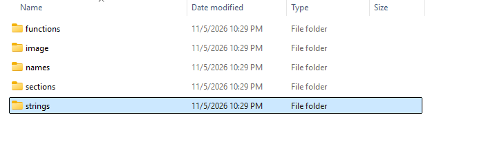
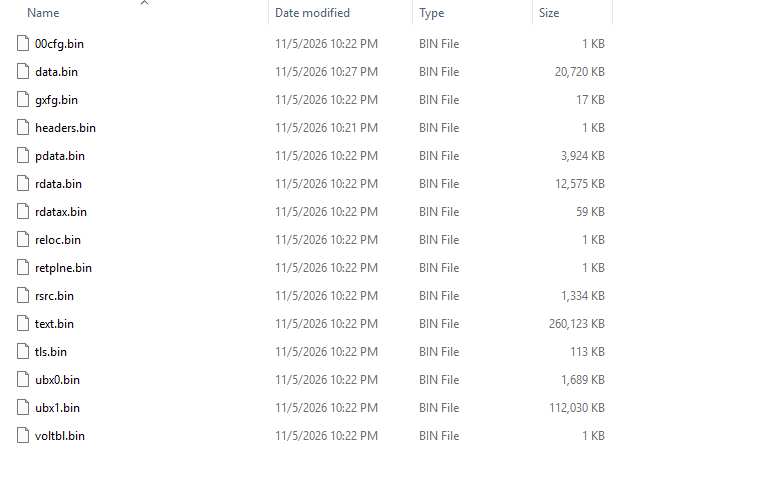
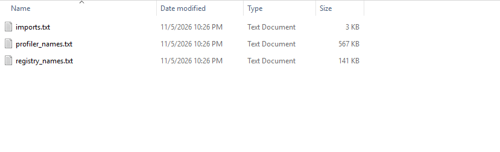
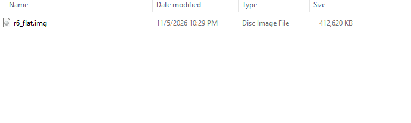
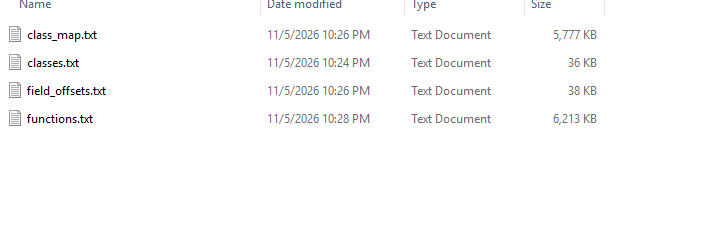

# r6 pe sections, functions and strings dump

full dump of RainbowSix.exe. all the pe sections decrypted for the most part, plus every named function, class, vtable, field offset, string and source path pulled straight out of it. basically a sdk for the entire game, tear it apart in ida and have fun

REVERSEKIDS - kai66712 on discord. if u got this anywhere else its most likely a virus

## sections

every pe section out of RainbowSix.exe. the exe is protected so a couple sections are still weird/encrypted but most of it is clean

**headers.bin** : pe headers, image base and where every section goes

**text.bin** : .text, 255mb of code. the actual game

**rdata.bin** : .rdata, 13mb. strings vtables imports

**rdatax.bin** : extra rdata section

**data.bin** : .data, 21mb of globals

**pdata.bin** : .pdata unwind info, every functions bounds

**rsrc.bin** : .rsrc resources, 1.4mb

**reloc.bin / tls.bin** : relocations and tls data

**00cfg.bin / gxfg.bin / retplne.bin / voltbl.bin** : the weird protection and control flow sections, cf guard stuff and volatile metadata the ac uses

**ubx0.bin / ubx1.bin** : ubisofts custom sections. ubx1 is 110mb

## functions

the sdk basically

**functions.txt** : 6mb of named functions with rvas, every vfunc for every class. runtime va is base plus rva

**class_map.txt** : 5.7mb, every class with its factory address, vtable address, and every vfunc resolved

**classes.txt** : class name to factory address list

**field_offsets.txt** : property records, field ids with their alloc and free function addresses

## names

**imports.txt** : the full import table resolved, address to dll and function name

**profiler_names.txt** : internal profiler and symbol names with where theyre referenced

**registry_names.txt** : the games class registry, every registered name mapped to its address

## strings

**strings.txt** : 30mb, every single string in the exe with rva offset and what section its in

**source_paths.txt** : internal build machine paths leaked from the binary, jenkins and wwise sdk paths

## image

**r6_flat.img** : the whole exe as a flat 403mb image, every section already laid out at its rva. load it raw if u dont wanna rebuild from sections

## screenshots

